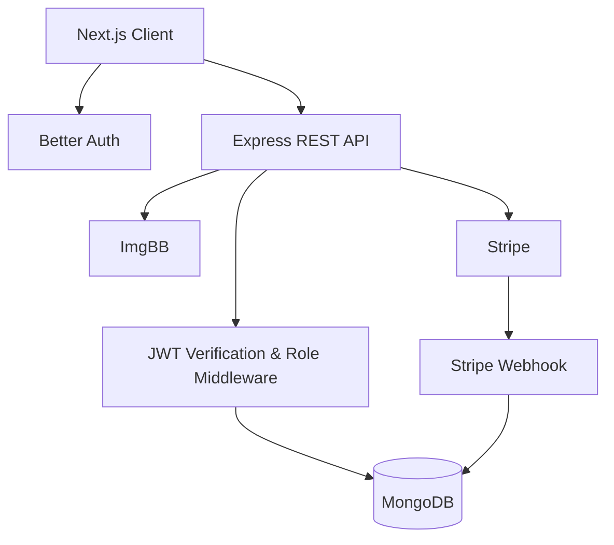

# 🍕 PizzaHub API

<div align="center">

### The engine behind PizzaHub

**REST API for menu management, order processing, vendor subscriptions, and platform administration.**


·[🌐 Live API]https://pizzahub-api-tasdid.vercel.app 
· [💻 Client Repository]https://github.com/tasdid-ahmed/pizzahub-client 
· [⚙️ Server Repository]https://github.com/tasdid-ahmed/pizzahub-client

</div>

---

## 📖 Overview

PizzaHub API is the backend service for **PizzaHub**, a full-stack pizza marketplace that connects customers with local pizza vendors.

Built with Express.js, TypeScript, and MongoDB, the API handles business logic, data validation, authentication verification, role-based access control, order management, menu moderation, vendor subscriptions, and administrative operations.

The API is deployed independently of the Next.js frontend, allowing the client and server to be developed and deployed separately.

---

## ✨ Core Responsibilities

- 🍕 Public menu browsing, search, filtering, sorting, and pagination.
- 🏪 Vendor menu creation, editing, availability, and ownership validation.
- 🛒 Customer order creation and management.
- 📦 Vendor order acceptance and rejection.
- 👤 User profile retrieval and updates.
- 🛡️ Role-based administrative operations.
- 🚫 User blocking and unblocking.
- 📋 Menu item moderation.
- 💳 Premium subscription checkout and cancellation.
- 🔔 Stripe webhook processing.
- 🖼️ Image uploads through ImgBB.
- 📊 Dashboard overview statistics and aggregations.

---

## 🧰 Tech Stack

| Technology | Purpose |
|---|---|
| Node.js | JavaScript runtime |
| Express 5 | REST API framework |
| TypeScript | Static typing |
| MongoDB Node.js Driver | Database operations |
| Zod | Request validation |
| Better Auth | Authentication system integrated with the client |
| JWT / JOSE | API token verification |
| Stripe | Subscription checkout and billing |
| ImgBB | Menu image hosting |
| Helmet | HTTP security headers |
| CORS | Cross-origin access control |
| Multer | Multipart image upload handling |
| dotenv | Environment configuration |
| Vercel Functions | Serverless database connection pooling support |

---

## 🏗️ Architecture



### Authentication Flow

1. Users authenticate through Better Auth on the Next.js client.
2. The client obtains a JWT token from Better Auth.
3. Protected API requests send the token through the `Authorization` header.
4. The backend verifies the token using Better Auth's JWKS endpoint.
5. User role, blocked status, and subscription status are retrieved from MongoDB.
6. Role middleware restricts access to the appropriate endpoints.

```http
Authorization: Bearer <token>
```

---

## 📁 Project Structure

```text
src/
├── app.ts
├── server.ts
│
├── config/
│   ├── db.ts
│   ├── env.ts
│   └── stripe.ts
│
├── controllers/
│   ├── adminMenu.controller.ts
│   ├── adminUsers.controller.ts
│   ├── order.controller.ts
│   ├── publicMenu.controller.ts
│   ├── subscription.controller.ts
│   ├── upload.controller.ts
│   ├── user.controller.ts
│   ├── vendorMenuItem.controller.ts
│   └── webhook.controller.ts
│
├── middlewares/
│   ├── errorHandler.ts
│   ├── requireRole.ts
│   ├── upload.ts
│   └── verifyToken.ts
│
├── routes/
│   ├── admin.routes.ts
│   ├── index.ts
│   ├── menu.routes.ts
│   ├── order.routes.ts
│   ├── subscription.routes.ts
│   ├── upload.routes.ts
│   ├── user.routes.ts
│   └── vendor.routes.ts
│
├── scripts/
│   └── make-admin.ts
│
├── services/
│   ├── adminMenu.service.ts
│   ├── adminUsers.service.ts
│   ├── menuItem.service.ts
│   ├── order.service.ts
│   ├── publicMenu.service.ts
│   ├── stripeWebhook.service.ts
│   ├── subscription.service.ts
│   ├── transaction.store.ts
│   └── upload.service.ts
│
├── types/
├── utils/
└── validators/
```

The backend follows a controller/service architecture:

- **Routes:** Endpoint definitions and middleware composition.
- **Controllers:** HTTP request and response handling.
- **Services:** Business logic and database operations.
- **Validators:** Input validation and request schemas.
- **Middlewares:** Authentication, authorization, file handling, and error handling.
- **Config:** Environment variables, MongoDB connection, and Stripe configuration.

---

## 🗄️ Database

PizzaHub uses MongoDB.

### Main collections

| Collection | Responsibility |
|---|---|
| `user` | User profiles, roles, blocking status, and vendor subscription information |
| `menuItems` | Menu listings, vendor ownership, pricing, images, availability, and moderation status |
| `orders` | Customer orders, vendor association, order status, delivery details, and timestamps |
| `transactions` | Vendor subscription transaction records and Stripe identifiers |

Better Auth manages its authentication-related data through its MongoDB adapter.

### Menu item statuses

- `pending`
- `approved`
- `rejected`
- `inactive`

New menu items are submitted for administrative review before they become publicly available.

### Order statuses

- `pending`
- `accepted`
- `rejected`
- `cancelled`

Order operations enforce ownership and valid status transitions.

---

## 🔐 Authentication & Authorization

Authentication is managed by Better Auth on the Next.js application. The backend verifies JWT tokens issued by the authentication system.

### Roles

| Role | Permissions |
|---|---|
| `customer` | Browse menus, place orders, view and manage their orders |
| `vendor` | Manage owned menu items, availability, and incoming orders |
| `admin` | Manage users, moderate menu items, and view platform transactions |

### Security measures

- JWT verification through JWKS.
- Role-based middleware.
- Database-backed role verification.
- Blocked-account checks.
- Ownership validation for vendor resources.
- Zod request validation.
- Whitelisted profile updates.
- Helmet security headers.
- Restricted CORS origin.
- Protected upload endpoint.
- Centralized error handling.

---

## 📡 API Reference

All backend API routes use the following prefix:

```text
/api
```

### Health

| Method | Endpoint | Description | Access |
|---|---|---|---|
| `GET` | `/api/health` | API and database health check | Public |

### User & Profile

| Method | Endpoint | Description | Access |
|---|---|---|---|
| `GET` | `/api/me` | Get authenticated user | Authenticated |
| `POST` | `/api/me/role` | Select account role | Authenticated |
| `GET` | `/api/me/profile` | Get profile details | Authenticated |
| `PATCH` | `/api/me` | Update profile | Authenticated |

### Public Menu

| Method | Endpoint | Description | Access |
|---|---|---|---|
| `GET` | `/api/menu-items` | List approved menu items | Public |
| `GET` | `/api/menu-items/featured` | Get featured menu items | Public |
| `GET` | `/api/menu-items/filters` | Get available menu filters | Public |
| `GET` | `/api/menu-items/:id` | Get menu item details | Authenticated |

**Menu listing query parameters**

| Parameter | Description |
|---|---|
| `q` | Search menu item name or description |
| `category` | Filter by menu category |
| `location` | Filter by location |
| `minPrice` | Minimum price |
| `maxPrice` | Maximum price |
| `sort` | `newest`, `price_asc`, `price_desc` |
| `page` | Page number |
| `limit` | Items per page (maximum 24) |

### Customer Orders

| Method | Endpoint | Description | Access |
|---|---|---|---|
| `POST` | `/api/orders` | Place an order | Customer |
| `GET` | `/api/customer/orders` | List customer orders | Customer |
| `PATCH` | `/api/customer/orders/:id/cancel` | Cancel eligible order | Customer |
| `GET` | `/api/customer/overview` | Customer dashboard statistics | Customer |

### Vendor Menu Management

| Method | Endpoint | Description | Access |
|---|---|---|---|
| `GET` | `/api/vendor/menu-items` | List vendor's menu items | Vendor |
| `POST` | `/api/vendor/menu-items` | Create menu item | Vendor |
| `GET` | `/api/vendor/menu-items/:id` | Get owned menu item | Vendor |
| `PATCH` | `/api/vendor/menu-items/:id` | Update owned menu item | Vendor |
| `PATCH` | `/api/vendor/menu-items/:id/availability` | Toggle item availability | Vendor |
| `DELETE` | `/api/vendor/menu-items/:id` | Delete owned menu item | Vendor |
| `GET` | `/api/vendor/overview` | Vendor dashboard statistics | Vendor |

### Vendor Orders

| Method | Endpoint | Description | Access |
|---|---|---|---|
| `GET` | `/api/vendor/orders` | List vendor's orders | Vendor |
| `PATCH` | `/api/vendor/orders/:id` | Accept or reject an order | Vendor |

### Admin — Users

| Method | Endpoint | Description | Access |
|---|---|---|---|
| `GET` | `/api/admin/overview` | Platform statistics | Admin |
| `GET` | `/api/admin/users` | List/search/filter users | Admin |
| `GET` | `/api/admin/users/:id` | Get user details and related statistics | Admin |
| `PATCH` | `/api/admin/users/:id/block` | Block or unblock user | Admin |

### Admin — Menu Moderation

| Method | Endpoint | Description | Access |
|---|---|---|---|
| `GET` | `/api/admin/menu-items` | List and filter menu items | Admin |
| `PATCH` | `/api/admin/menu-items/:id/status` | Change menu item status | Admin |
| `DELETE` | `/api/admin/menu-items/:id` | Delete menu item | Admin |

### Admin — Transactions

| Method | Endpoint | Description | Access |
|---|---|---|---|
| `GET` | `/api/admin/transactions` | List subscription transactions | Admin |

Transaction endpoints are read-only for administrators.

### Image Upload

| Method | Endpoint | Description | Access |
|---|---|---|---|
| `POST` | `/api/uploads/image` | Upload image to ImgBB | Authenticated |

Uploads use `multipart/form-data`.

### Vendor Subscriptions

| Method | Endpoint | Description | Access |
|---|---|---|---|
| `GET` | `/api/subscription` | Get subscription status | Vendor |
| `POST` | `/api/subscription/checkout` | Create Stripe Checkout session | Vendor |
| `POST` | `/api/subscription/cancel` | Cancel subscription at period end | Vendor |

### Stripe Webhook

| Method | Endpoint | Description |
|---|---|---|
| `POST` | `/api/webhooks/stripe` | Process Stripe subscription events |

Webhook signature verification is used to validate incoming Stripe events.

---

## 💳 Vendor Subscription Plans

### Free Plan

- Up to **3 live menu items**.
- Live items include pending and approved listings.
- Vendors can manage availability and orders.

### Premium Plan

- **$9.99 USD per month**
- Unlimited menu items.
- Premium vendor badge.
- Featured menu placement.

Premium subscription checkout and billing are handled through Stripe.

---

## ⚙️ Environment Variables

Create a `.env` file in the project root.

| Variable | Required | Description |
|---|---|---|
| `PORT` | No | API server port (default: `5000`) |
| `NODE_ENV` | No | Runtime environment |
| `MONGODB_URI` | Yes | MongoDB connection string |
| `MONGODB_DB` | Yes | MongoDB database name |
| `CLIENT_URL` | Yes | Frontend URL used for CORS and JWT verification |
| `IMGBB_API_KEY` | Optional* | ImgBB API key for image uploads |
| `STRIPE_SECRET_KEY` | Optional* | Stripe secret API key |
| `STRIPE_WEBHOOK_SECRET` | Optional* | Stripe webhook signature secret |

\*Required for the respective integration to work.

> `STRIPE_PUBLISHABLE_KEY` may appear in the sample environment file, but the API currently does not read it.

---

## 🚀 Local Development

### Prerequisites

- Node.js
- npm
- MongoDB
- PizzaHub client running
- ImgBB API key (for image uploads)
- Stripe account and webhook configuration (for subscriptions)

### 1. Clone the repository

```bash
git clone https://github.com/tasdid-ahmed/pizzahub-server.git
cd pizzahub-server
```

### 2. Install dependencies

```bash
npm install
```

### 3. Configure environment variables

Copy `.env.example` to `.env` and fill in your configuration.

```bash
cp .env.example .env
```

### 4. Start the development server

```bash
npm run dev
```

The API will run at:

```text
http://localhost:5000
```

Health endpoint:

```text
http://localhost:5000/api/health
```

### 5. Available scripts

| Command | Description |
|---|---|
| `npm run dev` | Start development server with `tsx watch` |
| `npm run build` | Compile TypeScript |
| `npm run start` | Start compiled server |
| `npm run typecheck` | Run TypeScript type checking without output |
| `npm run make-admin -- email@example.com` | Assign admin role to an existing user |

---

## 👑 Creating an Admin Account

The `make-admin` script promotes an existing registered user to the admin role.

1. Create an account through the PizzaHub client.
2. Ensure the user exists in MongoDB.
3. Run the following command from the server project:

```bash
npm run make-admin -- user@example.com
```

The script assigns the `admin` role to the matching user.

---

## 🧪 Validation & Error Handling

Request bodies and query parameters are validated using Zod.

The API uses centralized error handling for:

- Application errors.
- Validation errors.
- Invalid JSON.
- File upload errors.
- Missing routes.
- Unexpected server errors.

### Error response format

```json
{
  "success": false,
  "message": "Validation failed",
  "code": "VALIDATION_ERROR",
  "details": {}
}
```

---

## 🌐 Deployment

The backend is designed to be deployed independently of the frontend. It can be deployed to a Node.js hosting environment such as Vercel.

Configure the production environment variables before deployment:

- MongoDB connection and database.
- `CLIENT_URL` with the deployed client origin.
- ImgBB API key.
- Stripe secret and webhook credentials where subscriptions are enabled.

Ensure the client origin is correctly configured for CORS and Better Auth JWT verification.

---

## 🔗 Related Project

| Repository | Description |
|---|---|
| PizzaHub Client | Next.js frontend, authentication, UI, and dashboards |
| PizzaHub Server | Express API, business logic, MongoDB operations, and integrations |

---

<div align="center">

### Built with TypeScript, Express, MongoDB, and 🍕

**PizzaHub API — powering the PizzaHub experience.**

</div>
